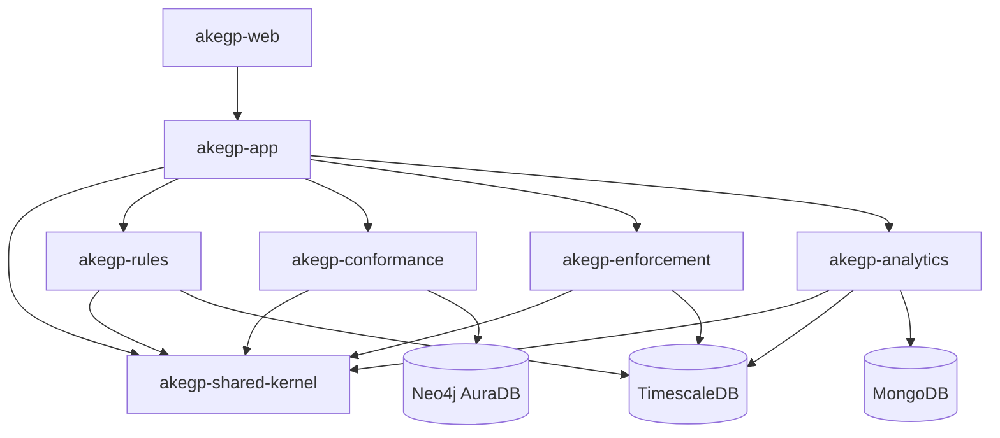

# AKEGP

AKEGP (Architecture Knowledge Extraction and Governance Platform) is a Java 25/Spring Boot 4.1 modular monolith skeleton with a React/Vite frontend. This repository intentionally contains contracts, composition points, health endpoints, and placeholders only.

## Run

* Create a free Neo4j AuraDB instance, then put `NEO4J_URI`, `NEO4J_USER`, and `NEO4J_PASSWORD` in the repository root `.env` file. Use the Aura `neo4j+s://...` connection URI and keep the file uncommitted.
* Put the Neon PostgreSQL connection in the repository root `.env` as `AKEGP_RULES_DB_URL`, `AKEGP_RULES_DB_USER`, and `AKEGP_RULES_DB_PASSWORD`. Project creation and the rules module use this Neon database. Keep the file uncommitted.
* For the remaining local relational services, Docker Compose starts PostgreSQL/TimescaleDB at `localhost:5432` and MongoDB at `localhost:27017`. Aura is hosted by Neo4j.
* Verify Java modules: `mvn clean verify`
* Build the backend: `mvn -pl akegp-app -am package`
* Run the backend in PowerShell with Java 25: `& "$env:JAVA_HOME\bin\java.exe" -jar akegp-app/target/akegp-app-0.1.0-SNAPSHOT.jar`
* Run the frontend: `cd akegp-web` then `npm ci` and `npm run dev`

The app uses PostgreSQL/TimescaleDB for relational and time-series ownership, Neo4j AuraDB for conformance, and MongoDB for analytics explanation documents. AuraDB Free is intended for learning, prototyping, and small projects and currently has a 1 GB storage limit. Module boundaries are guarded by ArchUnit.

For a local backend run, Spring Boot automatically loads the repository root `.env` file. Aura credentials are available from the Aura Console's connection details.

## Module/dependency diagram

