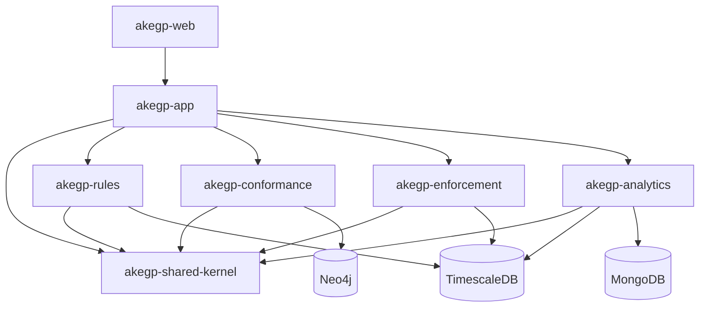

# AKEGP

AKEGP (Architecture Knowledge Extraction and Governance Platform) is a Java 25/Spring Boot 4.1 modular monolith skeleton with a React/Vite frontend. This repository intentionally contains contracts, composition points, health endpoints, and placeholders only.

## Run

* Start databases: `docker compose up timescaledb neo4j mongodb`
* Verify Java modules: `mvn clean verify`
* Run the backend: `mvn -pl akegp-app -am spring-boot:run`
* Run the frontend: `cd akegp-web` then `npm ci` and `npm run dev`

The app uses PostgreSQL/TimescaleDB for relational and time-series ownership, Neo4j for conformance, and MongoDB for analytics explanation documents. Module boundaries are guarded by ArchUnit.

## Module/dependency diagram

